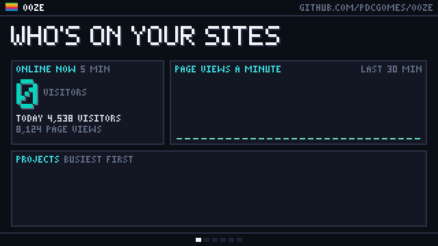
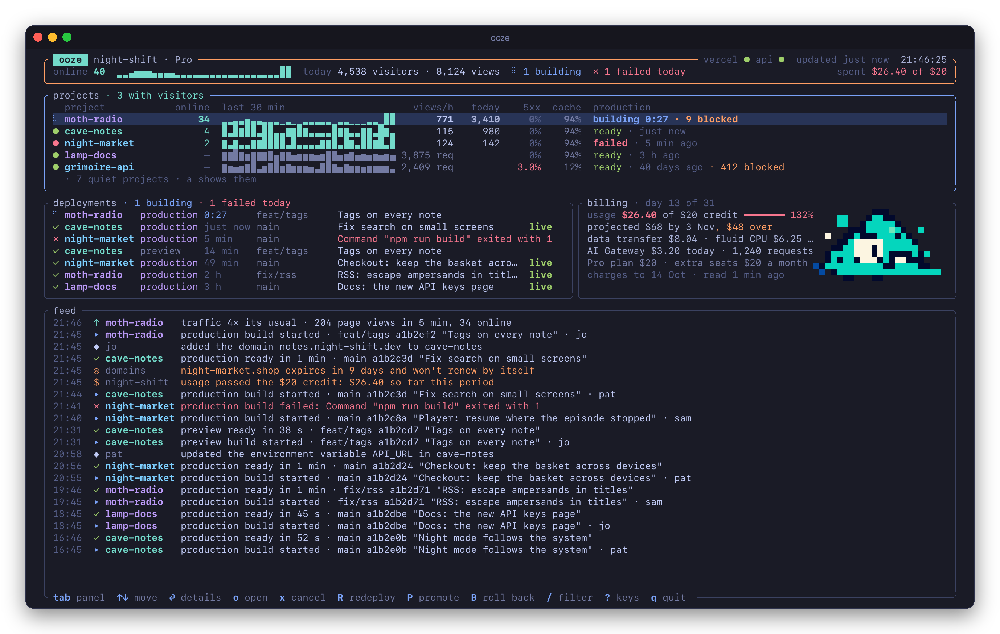
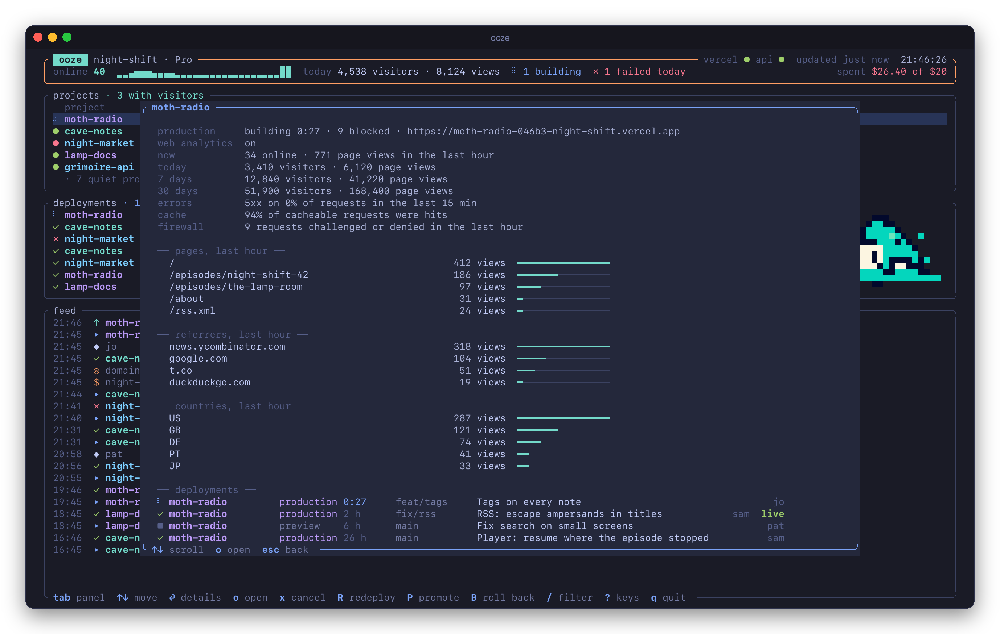
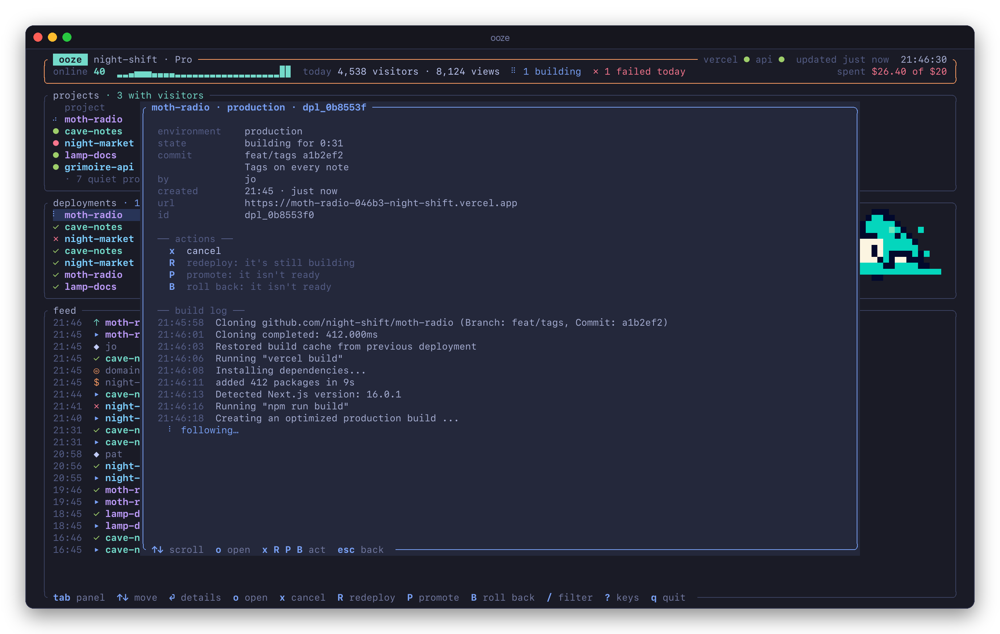
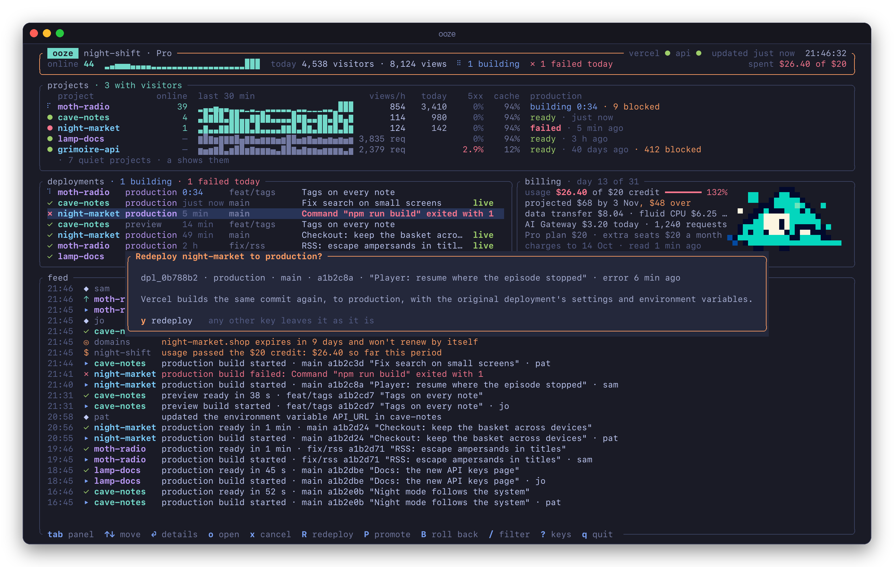
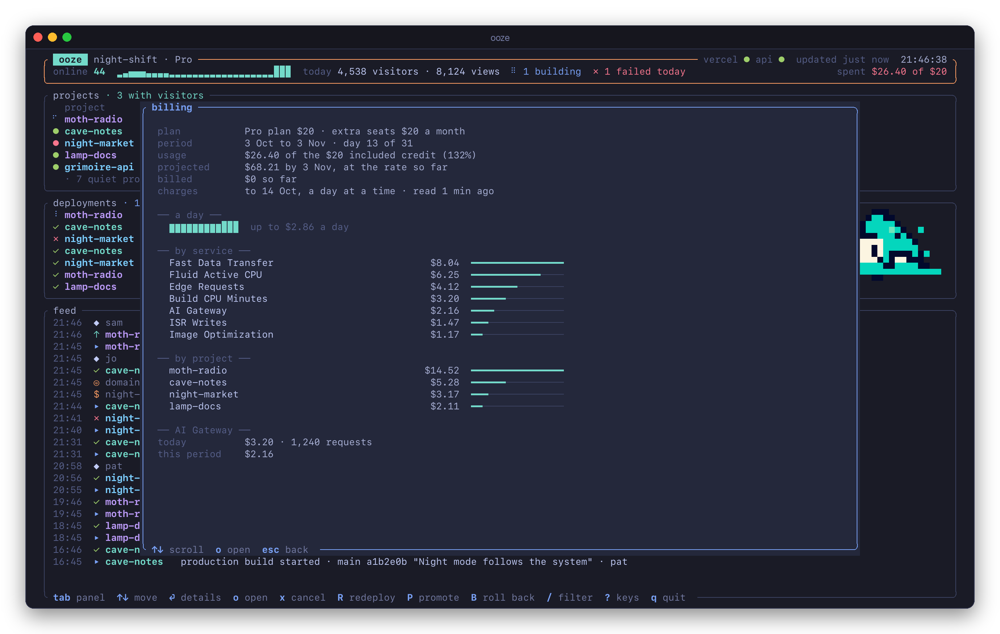

<h1 align="center"></h1>

<p align="center">Your Vercel projects, live, in a terminal: who's on each site right now, what's deploying, what's failing, and what it all costs.</p>

<p align="center"></p>

ooze can cancel, redeploy, promote and roll back, each after you confirm, and it notifies you when a production deploy fails or traffic spikes. It's in the style of [sweep](https://github.com/pdcgomes/sweep) and [haunt](https://github.com/pdcgomes/haunt)'s hauntop, in Tokyo Night, and its creature is [badcoffee.dev](https://badcoffee.dev)'s Slime, which is shaped like a triangle. It isn't affiliated with Vercel.



## Install

ooze runs on macOS and Linux and builds with Rust 1.88 or later:

```sh
cargo install --git https://github.com/pdcgomes/ooze --locked
```

`ooze demo` shows it on a made-up team, before signing in.

## Signing in

ooze uses the first of these it finds:

1. `VERCEL_TOKEN`.
2. A token `ooze login` saved. Create one at [vercel.com/account/settings/tokens](https://vercel.com/account/settings/tokens); it can be limited to one team and given an expiry. It's kept in `~/.config/ooze/token`, readable only by you.
3. The Vercel CLI's login, if you've run `vercel login`. That token lasts hours and the CLI renews it with a refresh token that changes each time, so ooze never renews it itself, which would sign the CLI out: when it's about to expire, ooze runs `vercel whoami`, which renews it, and reads it again.

It watches the team `--team` names, else `team` in the settings, else the Vercel CLI's current team, else your only one. `t` switches between your teams.

## What it shows

- **The header:** who's online across every project, page views a minute, today's visitors and page views, builds running, production failures today, and spend against the plan's credit. The lights are Vercel's status page and the API. Its border turns orange when something needs you, such as a failed production deploy, an error spike, an attack or an incident, and red when Vercel can't be reached.
- **Projects,** busiest first: who's online, page views a minute for the last 30 minutes, page views in the last hour, visitors today, the share of requests answered with a 5xx in the last 15 minutes, cache hits, and the production deployment: building, failed or ready, with requests the firewall challenged or denied. Projects without Web Analytics show requests instead of page views. Quiet ones fold into one line, which `a` opens.
- **Deployments:** building and queued ones first, then the newest across every project, each with its environment, branch, commit message and author. A failed one says why. `live` marks the one serving production, which ooze works out from the last promote or roll back as well as the newest ready deployment.
- **Billing:** the period, metered usage against the plan's included credit, where it's heading by the period's end, the costliest services, AI Gateway's spend today or its budget, and what the plan and seats cost a month.
- **The feed:** deploys starting, finishing and failing; traffic and error spikes; attacks the firewall is mitigating; Vercel's anomaly alerts; your team's activity, such as environment variables changed and domains added; status-page incidents; domains expiring or misconfigured; usage passing the credit; and what you did from ooze.
- **The Slime** sits beside the billing figures, glows when something happens, blinks now and then, and sleeps when Vercel can't be reached.

"Online" is unique visitors in the last 5 minutes. Page views and visitors come from Vercel's Observability API in one-minute buckets, about a minute behind, and refresh every 10 seconds.

## Details

⏎ opens what's selected. A project's details have where its visitors came from in the last hour (pages, referrers, countries), its 5xx by route, its visitors over 7 and 30 days, and its recent deployments.



A deployment's details have its commit, its URL, the actions that apply to it, and its build log, which follows a running build line by line.



## Actions

| Key | Does |
|---|---|
| `x` | Cancels a build that's queued or running. |
| `R` | Redeploys a deployment: the same commit, to the same environment, with the original's settings and environment variables. |
| `P` | Promotes a ready deployment to production. A preview deployment is built again with production's environment variables first. |
| `B` | Rolls production back to an earlier production deployment. Vercel then stops assigning new production deployments until one is promoted again. |

Each asks first, and says what will happen. `y` goes ahead; any other key leaves things as they are. When an action doesn't apply (rolling back to a build that's still running, say), ooze says why instead of asking.



`read_only = true` in the settings, or `--read-only`, turns the actions off.

## Billing



Spend comes from Vercel's billing charges, a day at a time; the latest is yesterday's. On Pro, the plan's $20 a month comes with $20 of usage credit, and the charges count the plan itself as a day-by-day subscription, so ooze leaves the plan and seats out of the usage it measures against the credit, and lists them apart. Days are kept in ooze's cache folder once fetched; each refresh fetches only the last two again, which Vercel may still be adding to. A token whose role can't see billing gets a line saying so, and everything else carries on.

## Notifications

ooze notifies when:

- a production deployment fails (and, if you turn it on, when one goes live)
- traffic spikes: 5 minutes of page views at least 3 times the last hour's 5-minute average, and at least 30
- errors spike: 5xx at least 5% of at least 50 requests in 5 minutes
- the firewall is mitigating an attack
- Vercel's status page reports an incident
- a domain expires within 14 days and won't renew by itself
- usage passes the plan's credit

Each is a setting, and so is every threshold. Notifications go to Notification Center on macOS and to `notify-send` on Linux, or to the terminal itself (`"terminal"` in the settings), which iTerm2, Ghostty and WezTerm show. What was already so when ooze started goes in the feed without a notification.

The open view sends them while it runs. `ooze watch` does the same without the interface, and `ooze agent install` starts it at login, as a LaunchAgent on macOS or a systemd user unit on Linux; it only notifies, and never acts on anything. Only one process sends them at a time, so they never come twice.

```sh
ooze agent install
ooze agent status
ooze agent uninstall
```

## Keys

| Key | |
|---|---|
| tab, shift-tab | move between the panels; the one outlined in blue has the selection |
| ↑ ↓, j k | move; moving in the feed pauses it |
| ⏎ | details |
| `o` | open what's selected in the browser: a deployment, a project's dashboard, the usage page |
| `x` `R` `P` `B` | cancel, redeploy, promote, roll back, each confirmed |
| `/` | filter projects, deployments and the feed by what they say |
| `1`–`7` | show or hide deploys, traffic, errors, Vercel, team, domains and spend in the feed; `0` shows them all |
| `p` | pause the feed, or carry on |
| `a` | show the quiet projects too |
| `z` | the selected panel on its own |
| `r` | ask Vercel for everything again now |
| `t` | watch your next team |
| `?` | the keys |
| `q` | quit |

The mouse picks a panel and scrolls it. Below 120 columns the billing panel folds into the header.

## Without the interface

```sh
ooze --once     # one glance as text: what an agent can run to see what's happening
ooze --json     # the same as JSON
ooze status     # who ooze is signed in as, how, which team, and the rate limits left
```

## Settings

ooze writes `~/.config/ooze/config.toml`, with comments, the first time it runs, and `ooze config` prints it. Every key is optional.

```toml
team = ""            # the team to watch, by slug; empty for the CLI's current one or your only one
read_only = false    # turns the actions off
refresh = 10         # seconds between refreshes of the live numbers
quiet_below = 1      # projects with fewer page views than this in the last hour fold away

[notify]
to = ["desktop"]     # and/or "terminal"; [] turns them off
deploy_failed = true
deploy_ready = false
traffic_spike = true
error_spike = true
attack = true
incident = true
domain_expiring = true
credit_used = true

[thresholds]
spike_factor = 3.0
spike_min_views = 30
error_rate = 0.05
error_min_requests = 50
domain_days = 14
```

## How it works

A thread fetches each source on its own clock and the view folds in what each says:

| What | From | How often |
|---|---|---|
| Who's online, page views a minute | Vercel's Observability API: Web Analytics page views, summed and counted by visitor, for the whole team at once | 10 s |
| Requests, 5xx, cache hits, firewall | The same API: requests by status and cache result, firewall actions | 30 s |
| Today's visitors and page views | The same, in one bucket from local midnight | 5 min |
| Deployments | `/v7/deployments`, every project at once | 5 s while one builds, 15 s otherwise |
| Projects | `/v10/projects`: Web Analytics on or off, production, the last promote or roll back | 5 min |
| Spend | `/v1/billing/charges`, FOCUS rows a day at a time, and the team's plan and credit | 30 min |
| Activity, alerts, attacks | `/v3/events`, Vercel's anomaly alerts, the firewall's attack status | 1 to 2 min |
| Domains | `/v5/domains` and each domain's DNS configuration | hourly |
| Vercel's status | `vercel-status.com` | 2 min |

A project's details ask for its pages, referrers and countries when opened, and a deployment's details stream its build log. It reads Vercel's rate limits from each answer and slows down when one runs low, and waits longer after each failure. Steady, it makes about 20 observability queries a minute, of the 100 Vercel allows. Requests go through the proxy `HTTPS_PROXY` names, if any.

**What it costs:** it draws when something changes, ten times a second while something moves on screen, and once a second otherwise. Over a minute watching a team with 16 projects it used 0.2% of one core and 24 MB of memory; the demo, which moves more, used 0.6% (15 October 2026).

## Develop

```sh
cargo test                 # parsing, billing, the rules, frames of the demo, keys, a stand-in Vercel
cargo run -- demo          # the view on the made-up team
cargo run -- snapshot --demo --width 120 --height 40 --keys '\t\n'   # one frame as text, after some keys
python3 scripts/capture.py # the README's pictures, from the demo (pip install pyte pillow fonttools)
```

`docs/plans/2026-10-15-ooze-design.md` is the design, with the endpoints it rests on. The title at the top and the 30-second video are drawn with [pixelartvisuals](https://github.com/pdcgomes/pixelartvisuals)' kit, in its `projects/ooze`.

## License

[MIT](LICENSE). The Slime is badcoffee.dev's.
